# sciart

[](https://github.com/nilesh-patil/sciart/actions/workflows/ci.yml)
[](LICENSE)
[](rust-toolchain.toml)

Real-time generative science art for the terminal: physics, chemistry, biology, Earth and
space. **85 animated scenes** drawn in braille and half-block cells at 30 FPS — and it keeps
your machine awake while you watch.

**[Play the scenes in your browser](https://www.nilesh42.science/sciart/play/)** ·
[gallery](https://www.nilesh42.science/sciart/gallery/) ·
[user guide](https://www.nilesh42.science/sciart/guide/)

<p align="center">
  
</p>

## What's inside

Each scene is a small simulation of a real model, with a short science title in its corner.

| Domain | Category | Scenes | What it shows | For example |
| --- | --- | ---: | --- | --- |
| Physics | Forces & Waves | 14 | Chaos, waves and flow: pendulums, interference, eddies, convection, collider tracks | `double_pendulum`, `vortex_street`, `chladni_plate` |
| | States of Matter | 8 | Matter ordering itself: crystals, magnetic domains, unmixing, a gas condensing, the hydrogen atom | `snowflake_growth`, `ising_model`, `electron_orbitals` |
| Chemistry | Reactions | 6 | Reactions that oscillate, spread or run away: chemical waves, Turing spots, catalysis, chain explosions | `belousov_zhabotinsky`, `gray_scott`, `liesegang_rings` |
| Life | Living Systems | 4 | Collective behaviour: a murmuration, fireflies flashing in step, a slime mould's network, Lenia | `firefly_sync`, `boids_flocking`, `physarum` |
| | Physics of Life | 4 | Physics inside living things: a nerve spike, a fibrillating heart, cell division, crowding bacteria | `action_potential`, `mitosis`, `heart_fibrillation` |
| | Molecules of Life | 3 | Molecules that copy and build: DNA replication, a ribosome making protein, amoebae calling with cAMP | `dna_helix`, `ribosome_translation`, `dicty_aggregation` |
| | Life from Matter | 3 | Molecules that organise themselves: protein folding, motor proteins walking, a protocell membrane | `protocell_assembly`, `hp_protein_folding`, `molecular_motors` |
| Earth | Earth & Sky | 10 | Earth's weather and sky: a hurricane, the aurora, a rainbow, an eclipse, the Moon's phases, star trails | `aurora`, `hurricane`, `total_solar_eclipse` |
| Space | Sun & Planets | 9 | The Sun and its planets: solar eruptions, Saturn's rings, Jupiter's storms, comets, a transit | `solar_system`, `saturn_rings`, `comet_tails` |
| | Deep Cosmos | 16 | Stars, galaxies and black holes: colliding galaxies, a pulsar, a supernova remnant, the oldest light | `galaxy_collision`, `black_hole`, `binary_inspiral` |
| | Voyages | 8 | Spaceflight: a launch, the Apollo 11 landing, gravity assists, a rendezvous, JWST unfolding | `rocket_launch`, `moon_landing`, `voyager_journey` |

## Gallery

### Physics

<p align="center">
  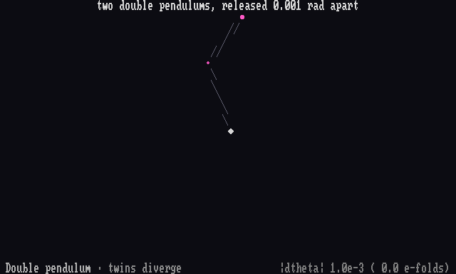
  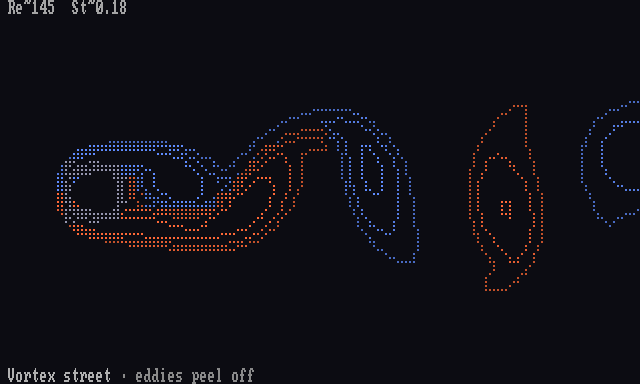
</p>
<p align="center"><sub>Double pendulum · Vortex street</sub></p>

<p align="center">
  
  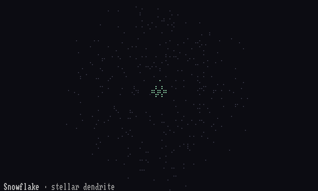
</p>
<p align="center"><sub>Hydrogen electron orbitals · Snowflake growth</sub></p>

### Chemistry

<p align="center">
  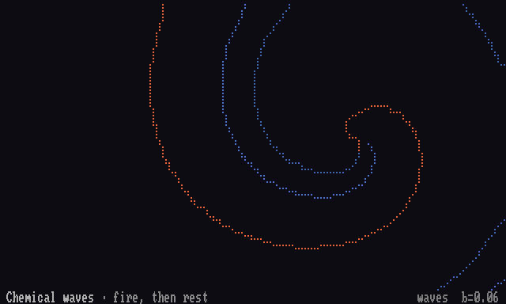
  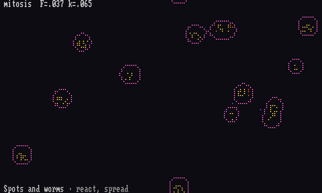
</p>
<p align="center"><sub>Belousov–Zhabotinsky spiral · Gray–Scott spots</sub></p>

### Life

<p align="center">
  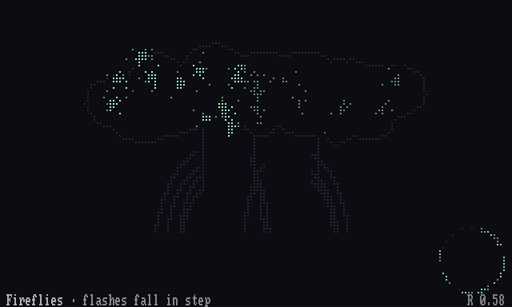
  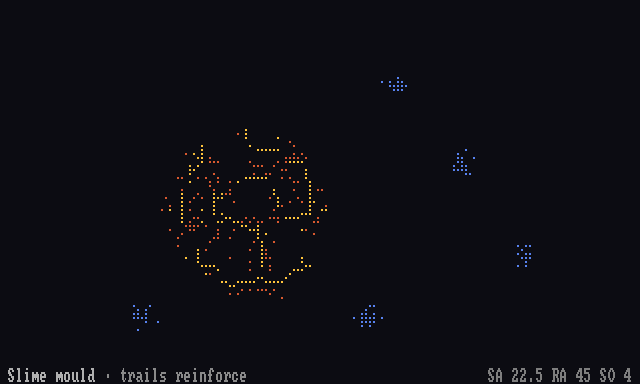
</p>
<p align="center"><sub>Fireflies falling into step · Slime mould network</sub></p>

<p align="center">
  
  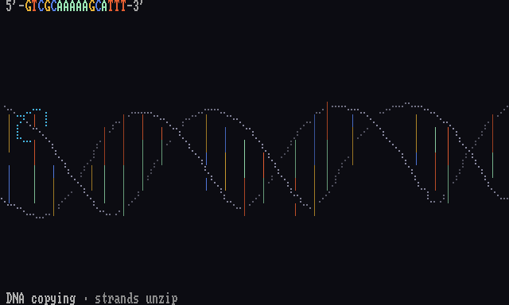
</p>
<p align="center"><sub>Mitosis · DNA replication</sub></p>

<p align="center">
  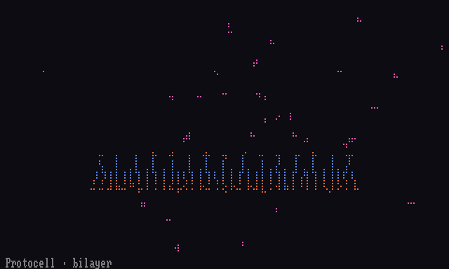
  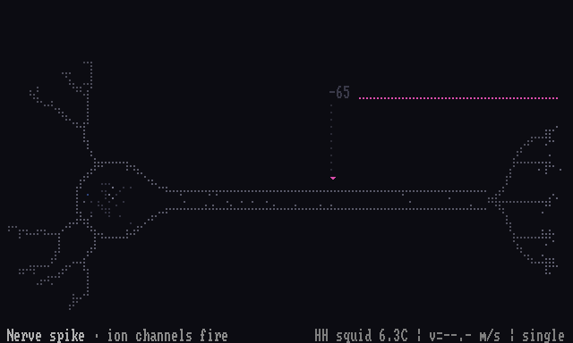
</p>
<p align="center"><sub>Protocell assembly · Nerve spike</sub></p>

### Earth

<p align="center">
  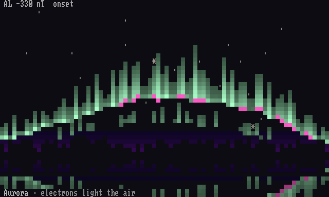
  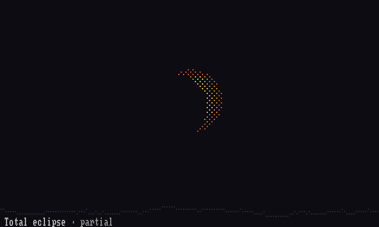
</p>
<p align="center"><sub>Aurora · Total solar eclipse</sub></p>

### Space

<p align="center">
  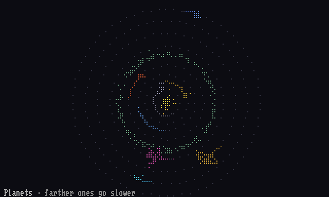
  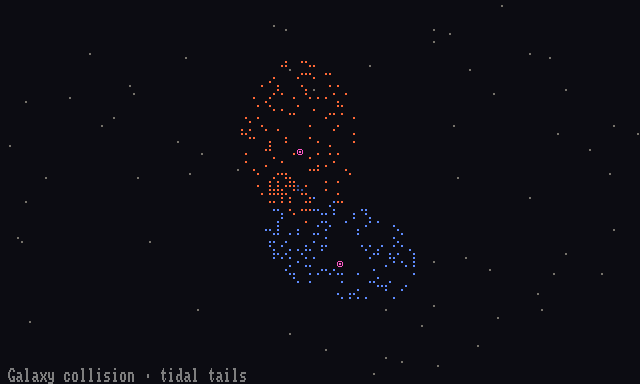
</p>
<p align="center"><sub>Solar system · Galaxy collision</sub></p>

<p align="center">
  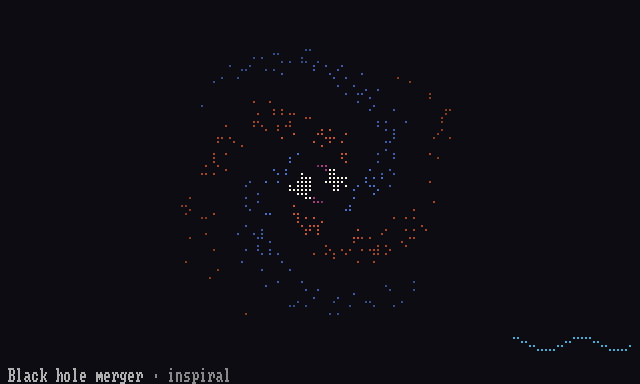
  
</p>
<p align="center"><sub>Binary inspiral · Rocket launch</sub></p>

<p align="center"><sub>Recorded with <code>sciart record</code> from <a href="docs/showcase.toml">docs/showcase.toml</a> — <a href="docs/GALLERY.md">full gallery</a>, with every scene and more clips</sub></p>

## Install

macOS (Apple Silicon or Intel) and Linux (x86_64 or ARM64).

**Installer script** (verifies the checksum, and the build provenance when `gh` is signed
in; installs to `~/.local/bin`, never uses sudo):

```sh
curl --proto '=https' --tlsv1.2 -LsSf https://github.com/nilesh-patil/sciart/releases/latest/download/install.sh | sh
```

**Homebrew**:

```sh
brew install nilesh-patil/sciart/sciart
```

**Cargo** (Rust 1.88 or newer):

```sh
cargo install sciart --locked      # builds from source
cargo binstall sciart              # downloads the release binary
```

**By hand**: download `sciart-<version>-<target>.tar.gz` and `SHA256SUMS` from the
[releases](https://github.com/nilesh-patil/sciart/releases), check it with
`shasum -a 256 -c SHA256SUMS --ignore-missing` (or `sha256sum -c --ignore-missing SHA256SUMS`
where `shasum` is not installed), unpack it with `tar -xzf`, and put the `sciart` binary
from the unpacked folder on your `PATH`. Each tarball also holds the bash, zsh and fish
completions and the manual pages; any build prints them with `sciart completions <shell>`
and `sciart man`.

The default build includes the headless recorder (`sciart record`); for a binary without
the image encoders, `cargo install sciart --locked --no-default-features --features cli`.

**From source**, to work on the project: clone it and install through the pixi task, which
builds the release profile of this checkout:

```sh
git clone https://github.com/nilesh-patil/sciart
cd sciart
pixi run rs-install
```

## Run

```sh
sciart                  # cycle all 85 scenes (the default `sim` mode)
sciart run double_pendulum        # one scene, full-screen: chaos from a tiny difference
sciart run belousov_zhabotinsky   # a chemical wave winding into a spiral
sciart run firefly_sync           # fireflies falling into step
sciart run aurora                 # auroral curtains over a northern lake
sciart run galaxy_collision       # two galaxies pulling out tidal tails
sciart --category reactions --category molecules-of-life   # cycle only these categories
sciart --only mitosis --only dna_helix --only protocell_assembly   # cycle a chosen few
sciart list             # every scene: name, category, description
sciart list --category life-from-matter   # the scenes of one category
sciart list --json      # the same catalogue for scripts: {"schema": 1, "scenes": [...]}
sciart record mitosis --seconds 5 --out mitosis.gif   # GIF, PNG frames or an asciicast
sciart frame snowflake_growth --t 20 --size 80x24     # one frame as ANSI text, for a MOTD or a log
sciart --for 25m        # end by itself after 25 minutes (90s, 25m, 1.5h; at most 24h)
sciart while -- make    # the art while `make` runs, then its output and exit status
sciart completions zsh  # shell completions (bash, zsh, fish, elvish, powershell)
sciart man              # the manual page, e.g. `sciart man > ~/.local/share/man/man1/sciart.1`
sciart man while        # one subcommand's page (sciart-while.1)
```

`sciart while -- <command>` gives the command no terminal: its stdin is empty and its
output is held back and printed, stdout then stderr, once the art closes, so it suits
builds, downloads and batch jobs, not editors or password prompts. It exits with the
command's status (`128 + n` after a signal). `q` closes the art early and keeps waiting
for the command; `Ctrl-C` stops it (exit 130); a `--for` deadline stops it (exit 124);
`SIGTERM` or `SIGHUP` stop it (exit 143 or 129); a command that cannot be started exits
127. The held output is not capped, so a command that writes gigabytes needs that much
temporary disk space. `sciart man while` has the details.

85 scenes across **11 categories** (see [What's inside](#whats-inside); `sciart list`
prints each one's category id). Five themes — `astro` (default), `rainbow`, `mono`,
`aurora` and the colour-blind-safe `colorblind` — cycle with `t`. The default frame rate is
30 FPS (`--fps 1..=120`).

## Keys

| Key | Action |
| --- | --- |
| `n` / `→` | next scene |
| `p` / `←` | previous scene |
| `space` | pause / resume |
| `r` | reset the current scene |
| `h` | toggle the HUD |
| `t` | cycle theme: astro → rainbow → mono → aurora → colorblind |
| `?` | help overlay (`Esc` closes it) |
| `f` | favourite the current scene |
| `v` | show only favourites |
| `[` / `]` | previous / next category |
| `s` | shuffle the cycle order |
| `q` / `Esc` / `Ctrl-C` | quit |

## Configure

The config file is `~/.config/sciart/config.toml` (or
`$XDG_CONFIG_HOME/sciart/config.toml`). Every key is optional; command-line flags override
the file. See [`docs/config.example.toml`](docs/config.example.toml) for every key, including
`favorites`, `speed`, `color` and the low-power `[low_power]` table.

## Colour

Truecolor is the default. `--color 256` quantizes every cell to the xterm-256 palette
(deterministic, for tmux and older terminals), and `--color mono` uses the greyscale theme.
`NO_COLOR=1` selects mono automatically (with one warning); an explicit
`--color truecolor|256|mono` overrides it.

For colour-blind viewers, `--theme colorblind` uses the Okabe–Ito palette: vermillion and
sky blue stand in for the red/green pair, and the field ramps run blue ↔ vermillion rather
than red ↔ green. `t` cycles to it after `aurora`.

## Platform

macOS and Linux are supported; Windows is not. Release binaries cover macOS on Apple
Silicon and Intel and Linux on x86_64 and ARM64; the Linux builds need glibc 2.35 or newer,
and a static musl build serves older systems (the installer script picks it). CI runs the
whole test suite on macOS on Apple Silicon and on Linux x86_64 and ARM64; the reviewed
reference frames are compared on macOS on Apple Silicon only, since frames can differ in the
last detail between platforms.

Keep-awake uses `caffeinate` on macOS and, on Linux, a
`systemd-inhibit` (or `elogind-inhibit`) lock held for as long as sciart runs; over SSH it
defaults to `off`, since keeping the remote machine awake is rarely what you want. Choose
explicitly with `--keep-awake caffeinate|inhibit|mouse|off`. The optional `mouse` jiggle
backend is behind the `mouse` cargo feature and needs macOS Accessibility permission.

When the terminal is unlikely to show truecolor braille well (the Linux console, Apple
Terminal without `COLORTERM`, `screen` or `tmux`), sciart prints a one-line hint on exit;
choosing a colour mode explicitly silences it.

## Use it as a library

The `sciart` crate is also a library: run a scene without a terminal, list the scenes, turn a
frame into text, ANSI or a PNG, or draw a scene inside your own ratatui application. **Turn
the default features off**, or you also get the command line's dependencies:

```toml
[dependencies]
sciart = { version = "1", default-features = false, features = ["png", "widget"] }
```

```rust
use sciart::{Options, Stage, Theme};

let mut stage = Stage::new("aurora", 80, 24, Options::default().seed(7))?;
stage.advance(5.0)?;                        // simulated seconds, in fixed 1/60 s steps
print!("{}", stage.render_ansi(Theme::Astro)?);  // the bytes `sciart frame` prints
```

`png` adds `Stage::render_png`; `widget` adds `SceneWidget` for ratatui 0.30. Only the `sciart`
crate's library carries a stability promise; the crates behind it are internal. The same build,
scene, seed and size give the same frames on the same platform, not across platforms or
versions. Writing your own scene is possible behind `unstable-generator`, with no promise.
See `examples/headless.rs` and `examples/widget.rs` in `crates/sciart`.

## Versioning

From 1.0, sciart follows [semantic versioning](https://semver.org) for its command line,
config keys, scene names, the `list --json` output and the `sciart` library. The internal
`sciart-*` crates it is built from are published only because Cargo needs them, and carry no
promise. Changes are listed in the [changelog](CHANGELOG.md).

## Docs site

The docs site is live at **[nilesh42.science/sciart](https://www.nilesh42.science/sciart/)**:
the [user guide](https://www.nilesh42.science/sciart/guide/), a
[gallery](https://www.nilesh42.science/sciart/gallery/) of every scene and a
[player](https://www.nilesh42.science/sciart/play/) that runs the scenes in the browser,
compiled to WebAssembly from the same code; without WebAssembly the player shows the
recorded clips. `pixi run site-build` builds the same self-contained site from this
repository, and the guide's sources are in [docs/guide](docs/guide/index.md).

## How it works

```text
sciart-core        canvas, glyphs, inks, generator contract, fixed-step clock, seeded RNG
  → sciart-scenes-{physics,matter,life,earth,cosmos}   one module per scene, by category
  → sciart-generators   the registry facade over the scene crates (+ sciart-shared models)
  → sciart-render       themes, HUD, ratatui painting
  → sciart              the library facade (Stage, scenes, themes, widget) + CLI, TOML config,
                        runtime, event loop
14 crates · deterministic fixed 1/60 s step · seeded RNG · snapshot-tested
```

## Documentation

- [User guide](docs/guide/index.md): installing, running, keys, configuration, terminals,
  scripting, recording and the library
- [Full gallery](docs/GALLERY.md) and [changelog](CHANGELOG.md)
- [Contributing](CONTRIBUTING.md) and the [architecture guide](docs/ARCHITECTURE.md)
- [Master specification](docs/specs/sciart-specification.md) and the
  [component specs](docs/specs/) (`SPEC-001` … `SPEC-009`)
- [Roadmap](docs/ROADMAP.md), [architecture decisions](docs/adr/) and
  [how a release is made](docs/RELEASING.md)
- [Documentation map](docs/README.md)

## Contributing

Read [CONTRIBUTING.md](CONTRIBUTING.md). The gate is `pixi run rs-ci`; changes are spec-first
and test-first, and snapshots are reviewed before they are accepted.

## License

MIT — see [LICENSE](LICENSE).
