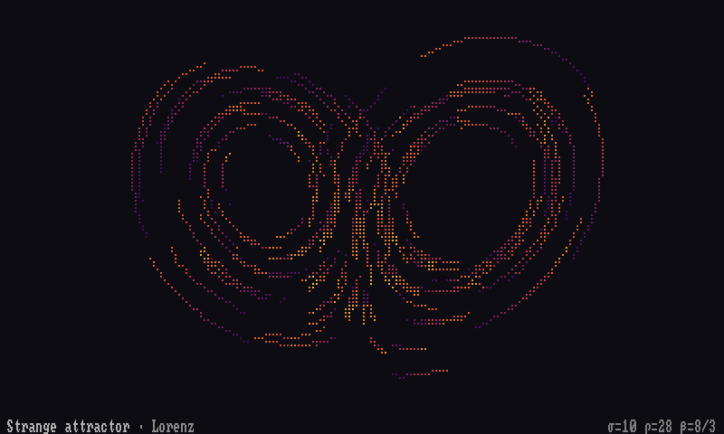
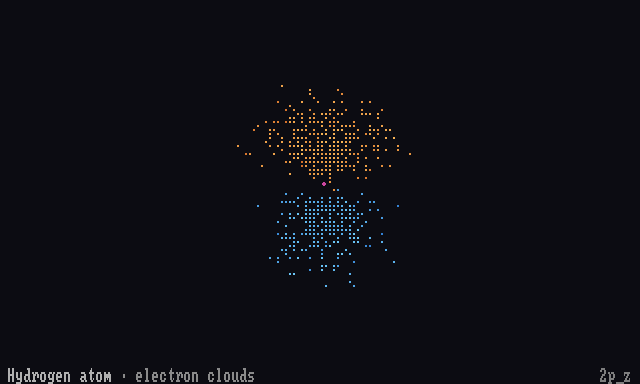
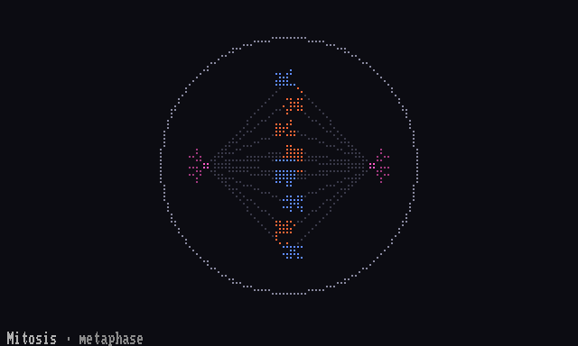
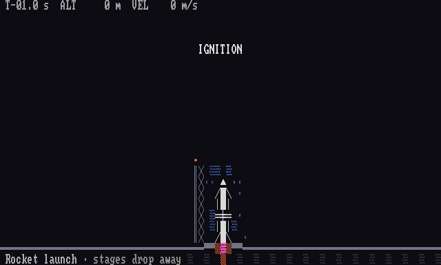

# sciart

[](https://github.com/nilesh-patil/sciart/actions/workflows/ci.yml)
[](LICENSE)
[](rust-toolchain.toml)

Real-time generative science & astronomy art for the terminal: **85 animated scenes** drawn in
braille and half-block cells at 30 FPS — and it keeps your machine awake while you watch.

<p align="center">
  
</p>

## Gallery

<p align="center">
  
  
</p>
<p align="center"><sub>Galaxy collision · Hydrogen electron orbitals</sub></p>

<p align="center">
  
  
</p>
<p align="center"><sub>Double pendulum · Binary inspiral</sub></p>

<p align="center">
  
  
</p>
<p align="center"><sub>Total solar eclipse · Solar system</sub></p>

<p align="center">
  
  
</p>
<p align="center"><sub>Belousov–Zhabotinsky spiral · Snowflake growth</sub></p>

<p align="center">
  
  
</p>
<p align="center"><sub>Mitosis · Vortex street</sub></p>

<p align="center">
  
  
</p>
<p align="center"><sub>Aurora · Rocket launch</sub></p>

<p align="center"><sub>Recorded with <code>sciart record</code> from <a href="docs/showcase.toml">docs/showcase.toml</a> — <a href="docs/GALLERY.md">full gallery</a>, with every scene and more clips</sub></p>

## Install

Requires [Rust](https://rustup.rs) 1.88 or newer.

```sh
cargo install --git https://github.com/nilesh-patil/sciart sciart --locked

# with the headless recorder (`sciart record`):
cargo install --git https://github.com/nilesh-patil/sciart sciart --features record --locked
```

Working on the project? Clone it and install through the pixi task instead:

```sh
git clone https://github.com/nilesh-patil/sciart
cd sciart
pixi run rs-install
```

Release tarballs and Homebrew formulae are planned but **not available yet**.

## Run

```sh
sciart                  # cycle all 85 scenes (the default `sim` mode)
sciart run aurora       # one scene, full-screen
sciart list             # every scene: name, category, description
sciart list --json      # the same catalogue for scripts: {"schema": 1, "scenes": [...]}
sciart record aurora --seconds 5 --out aurora.gif   # needs --features record
sciart --for 25m        # end by itself after 25 minutes (90s, 25m, 1.5h; at most 24h)
sciart while -- make    # the art while `make` runs, then its output and exit status
sciart completions zsh  # shell completions (bash, zsh, fish, elvish, powershell)
sciart man              # the manual page, e.g. `sciart man > ~/.local/share/man/man1/sciart.1`
sciart man while        # one subcommand's page (sciart-while.1)
```

`sciart while -- <command>` gives the command no terminal: its stdin is empty and its
output is held back and printed, stdout then stderr, once the art closes, so it suits
builds, downloads and batch jobs, not editors or password prompts. It exits with the
command's status (`128 + n` after a signal). `q` closes the art early and keeps waiting
for the command; `Ctrl-C` stops it (exit 130); a `--for` deadline stops it (exit 124);
`SIGTERM` or `SIGHUP` stop it (exit 143 or 129); a command that cannot be started exits
127. The held output is not capped, so a command that writes gigabytes needs that much
temporary disk space. `sciart man while` has the details.

85 scenes across **11 categories**. Five themes — `astro` (default), `rainbow`, `mono`,
`aurora` and the colour-blind-safe `colorblind` — cycle with `t`. The default frame rate is
30 FPS (`--fps 1..=120`).

## Keys

| Key | Action |
| --- | --- |
| `n` / `→` | next scene |
| `p` / `←` | previous scene |
| `space` | pause / resume |
| `r` | reset the current scene |
| `h` | toggle the HUD |
| `t` | cycle theme: astro → rainbow → mono → aurora → colorblind |
| `?` | help overlay (`Esc` closes it) |
| `f` | favourite the current scene |
| `v` | show only favourites |
| `[` / `]` | previous / next category |
| `s` | shuffle the cycle order |
| `q` / `Esc` / `Ctrl-C` | quit |

## Configure

The config file is `~/.config/sciart/config.toml` (or
`$XDG_CONFIG_HOME/sciart/config.toml`). Every key is optional; command-line flags override
the file. See [`docs/config.example.toml`](docs/config.example.toml) for every key, including
`favorites`, `speed`, `color` and the low-power `[low_power]` table.

## Colour

Truecolor is the default. `--color 256` quantizes every cell to the xterm-256 palette
(deterministic, for tmux and older terminals), and `--color mono` uses the greyscale theme.
`NO_COLOR=1` selects mono automatically (with one warning); an explicit
`--color truecolor|256|mono` overrides it.

For colour-blind viewers, `--theme colorblind` uses the Okabe–Ito palette: vermillion and
sky blue stand in for the red/green pair, and the field ramps run blue ↔ vermillion rather
than red ↔ green. `t` cycles to it after `aurora`.

## Platform

macOS and Linux are supported. Keep-awake uses `caffeinate` on macOS and, on Linux, a
`systemd-inhibit` (or `elogind-inhibit`) lock held for as long as sciart runs; over SSH it
defaults to `off`, since keeping the remote machine awake is rarely what you want. Choose
explicitly with `--keep-awake caffeinate|inhibit|mouse|off`. The optional `mouse` jiggle
backend is behind the `mouse` cargo feature and needs macOS Accessibility permission.

## How it works

```text
sciart-core        canvas, glyphs, inks, generator contract, fixed-step clock, seeded RNG
  → sciart-scenes-{cosmos,earth,physics,matter,life}   one module per scene, by category
  → sciart-generators   the registry facade over the scene crates (+ sciart-shared models)
  → sciart-render       themes, HUD, ratatui painting
  → sciart              CLI, TOML config, runtime, event loop
12 crates · deterministic fixed 1/60 s step · seeded RNG · snapshot-tested
```

## Documentation

- [Master specification](docs/specs/sciart-specification.md) and the
  [component specs](docs/specs/) (`SPEC-001` … `SPEC-006`)
- [Roadmap](docs/ROADMAP.md) and [architecture decisions](docs/adr/)
- [Improvement proposal](docs/IMPROVEMENTS.md) and [changelog](CHANGELOG.md)
- [Full gallery](docs/GALLERY.md)

## Contributing

Read [CONTRIBUTING.md](CONTRIBUTING.md). The gate is `pixi run rs-ci`; changes are spec-first
and test-first, and snapshots are reviewed by a person before they are accepted.

## License

MIT — see [LICENSE](LICENSE).
