# Gallery

Every one of the 85 registered scenes, one current frame each: astro theme at 160x48 cells (8x16 px per cell), seed 42, t = 20 s. A compare link, where present, shows the scene's historical looks side by side.

## Deep Cosmos

### `binary_inspiral`

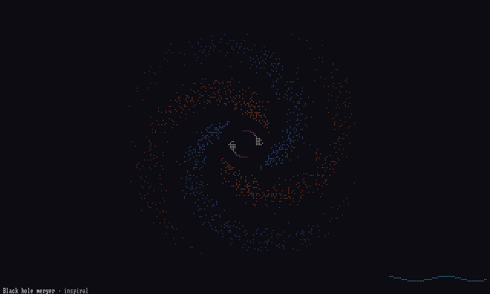

Two black holes spiral together and merge, radiating a two-armed gravitational-wave spiral

### `black_hole`

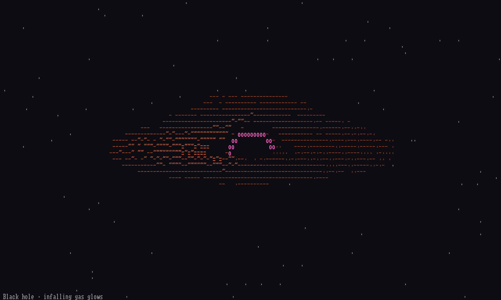

A black hole with a beamed, lensed accretion disk and photon ring

[Historical looks](../samples/compare/black_hole.png)

### `cosmic_microwave_background`

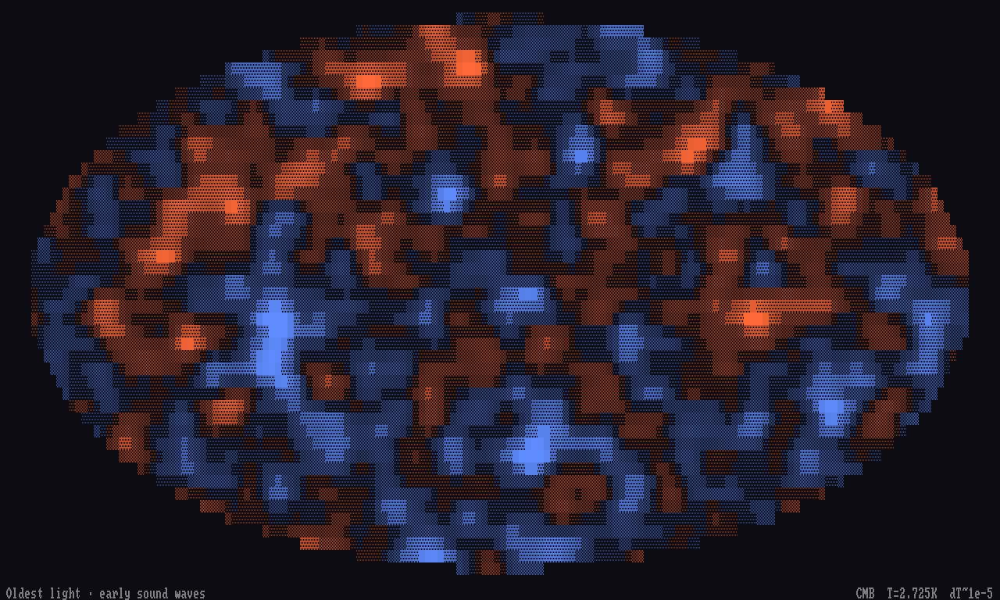

A shimmering Planck-style map of the CMB anisotropies

[Historical looks](../samples/compare/cosmic_microwave_background.png)

### `cosmic_web`

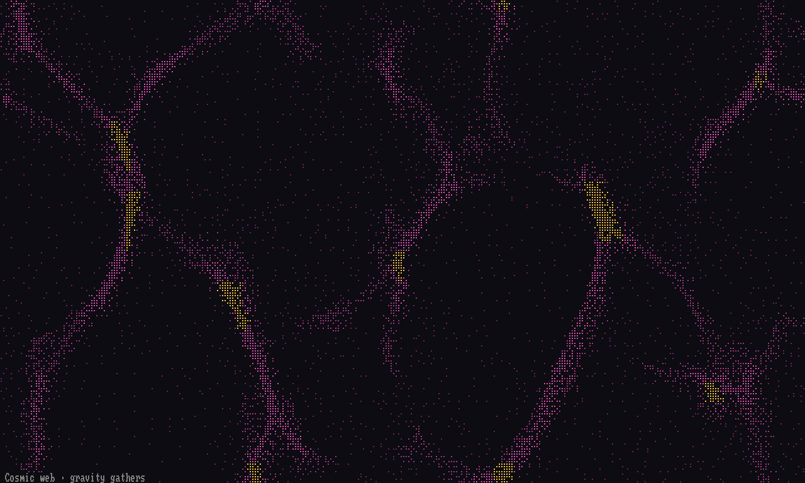

A smooth fog of dark matter collapsing into the sheets, filaments and knots of the cosmic web

[Historical looks](../samples/compare/cosmic_web.png)

### `galaxy_collision`

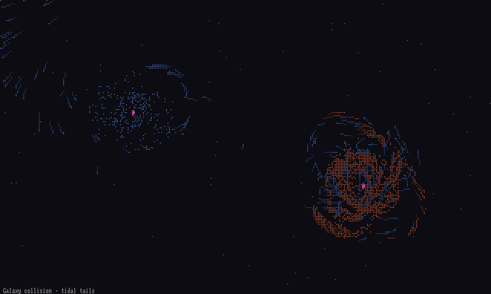

Two spiral galaxies colliding and pulling out tidal tails

[Historical looks](../samples/compare/galaxy_collision.png)

### `globular_cluster`

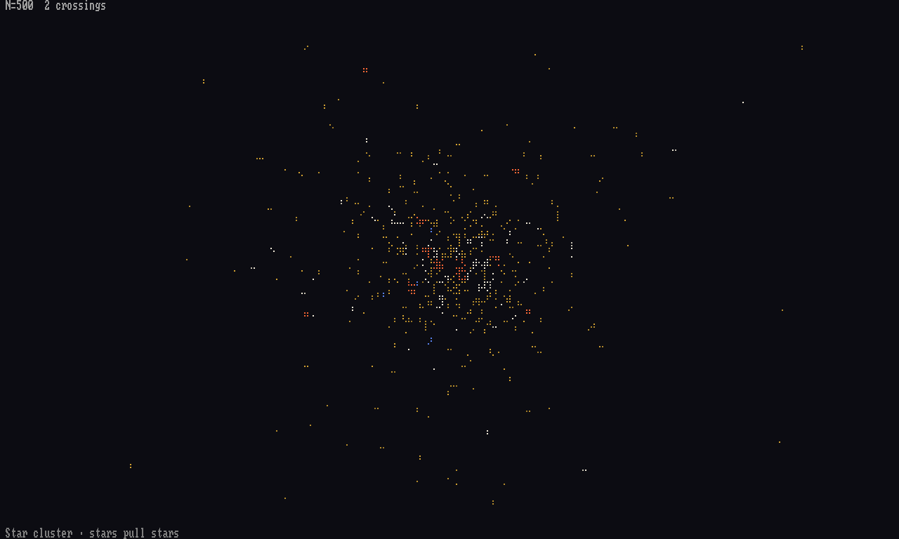

An ancient globular cluster of live gravitating stars, seen by a slowly turning telescope

[Historical looks](../samples/compare/globular_cluster.png)

### `gravitational_lensing`

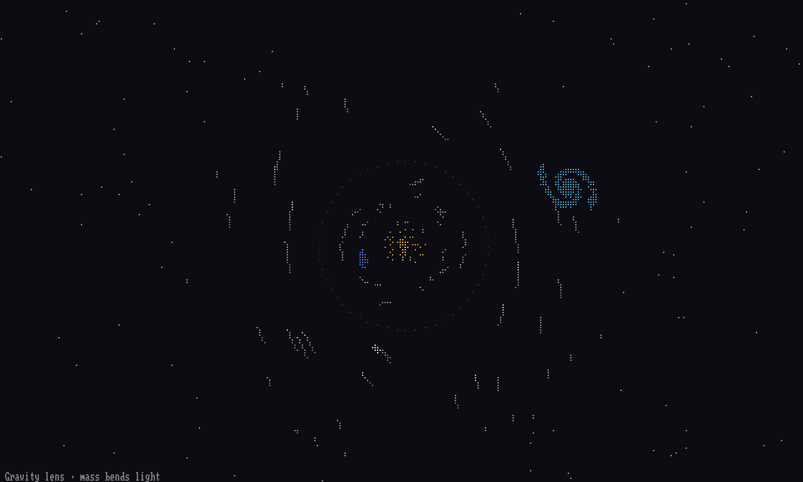

Stars and a galaxy lensed into double images and an Einstein ring

[Historical looks](../samples/compare/gravitational_lensing.png)

### `light_echo`

A stellar outburst lighting up surrounding dust in rings that sweep outward

[Historical looks](../samples/compare/light_echo.png)

### `planetary_nebula`

A dying star's slow wind and the bipolar lobes its fast wind blows through it

[Historical looks](../samples/compare/planetary_nebula.png)

### `pulsar`

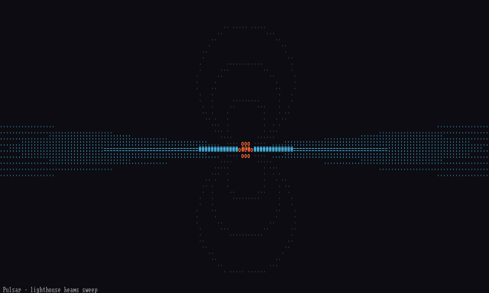

A lighthouse neutron star: two sweeping beams, dipole field loops, flashes

[Historical looks](../samples/compare/pulsar.png)

### `relativistic_jet`

The M87 jet: knots racing out at several times the apparent speed of light

[Historical looks](../samples/compare/relativistic_jet.png)

### `spacetime_grid`

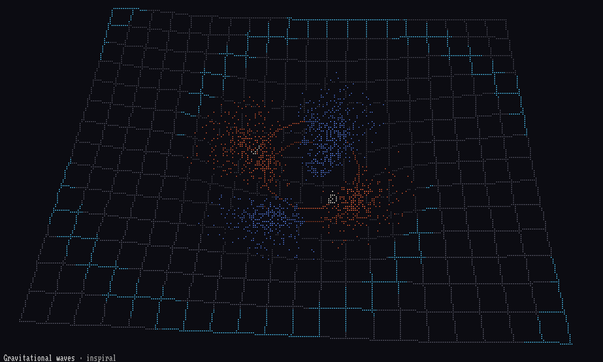

A rubber-sheet spacetime dimpled by an orbiting binary emitting gravitational waves

[Historical looks](../samples/compare/spacetime_grid.png)

### `spiral_galaxy`

Nested star orbits crowding into the six arms of a grand-design spiral

[Historical looks](../samples/compare/spiral_galaxy.png)

### `starfield`

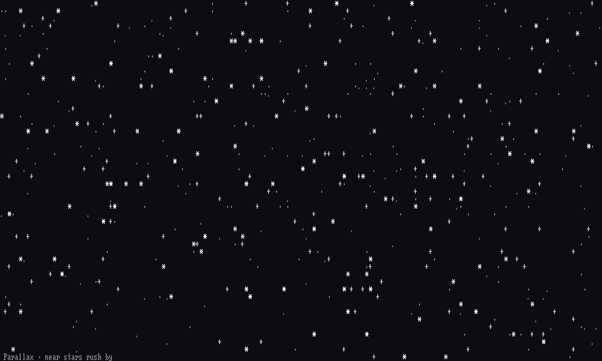

Parallax starfield drifting past, stars twinkling in and out

[Historical looks](../samples/compare/starfield.png)

### `stellar_nursery`

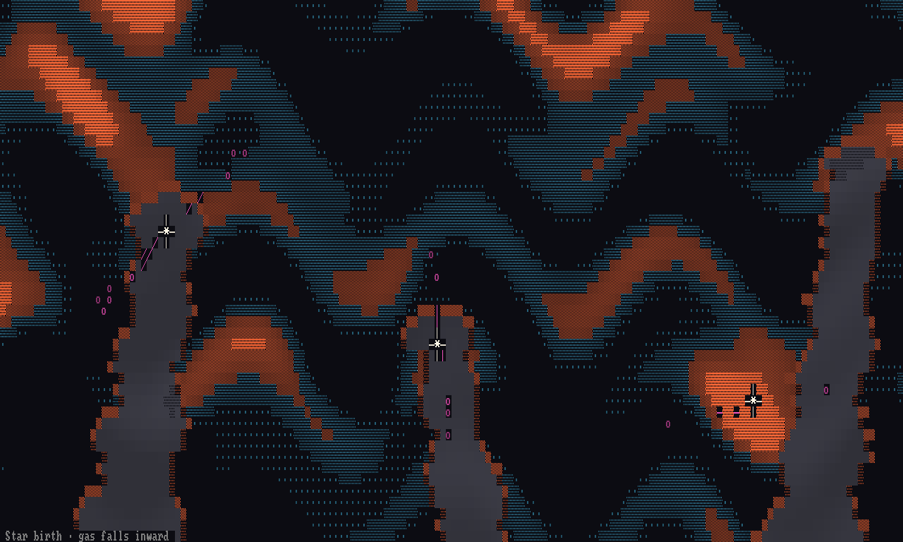

A glowing nebula where gas streams onto protostars that ignite

[Historical looks](../samples/compare/stellar_nursery.png)

### `supernova_remnant`

Ejecta knots of a young remnant, blue coming toward us and red going away, inside a racing blast wave

[Historical looks](../samples/compare/supernova_remnant.png)

## Sun & Planets

### `comet_breakup`

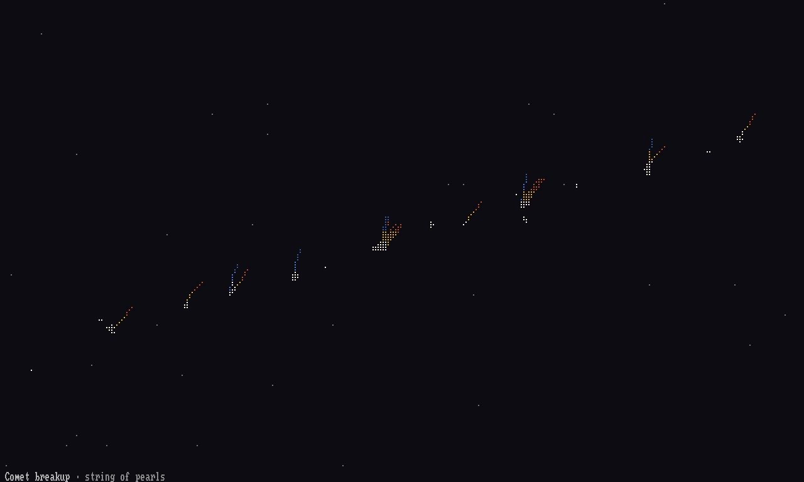

Shoemaker-Levy 9: Jupiter's tides tear a comet into a string of pearls

[Historical looks](../samples/compare/comet_breakup.png)

### `comet_tails`

A comet rounds the Sun: a curved dust tail pushed by light, a straight ion tail

[Historical looks](../samples/compare/comet_tails.png)

### `exoplanet_transit`

A planet transiting a limb-darkened star while its light curve dips

[Historical looks](../samples/compare/exoplanet_transit.png)

### `io_volcanoes`

Pele and Prometheus throw umbrella plumes on exact ballistic arcs that paint rings on Io

[Historical looks](../samples/compare/io_volcanoes.png)

### `jupiter_storms`

Jupiter's belts and zones sheared by jets, the Great Red Spot and white ovals

[Historical looks](../samples/compare/jupiter_storms.png)

### `saturn_rings`

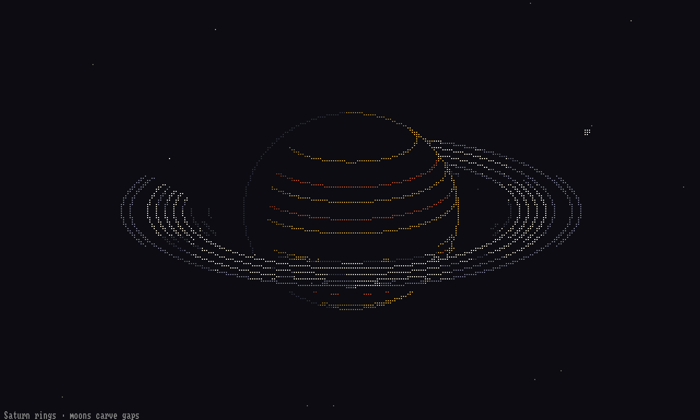

Saturn's tilted rings: Cassini Division, Encke and Keeler gaps, spokes, shadow

[Historical looks](../samples/compare/saturn_rings.png)

### `solar_eruption`

Loops rise and snap: a flux rope erupts, flare ribbons flash, a CME escapes

[Historical looks](../samples/compare/solar_eruption.png)

### `solar_surface`

The granulated Sun turning slowly, with sunspots, limb loops and coronal rain

[Historical looks](../samples/compare/solar_surface.png)

### `solar_system`

The eight planets orbiting the Sun at Kepler speeds, with an asteroid belt

[Historical looks](../samples/compare/solar_system.png)

## Earth & Sky

### `aurora`

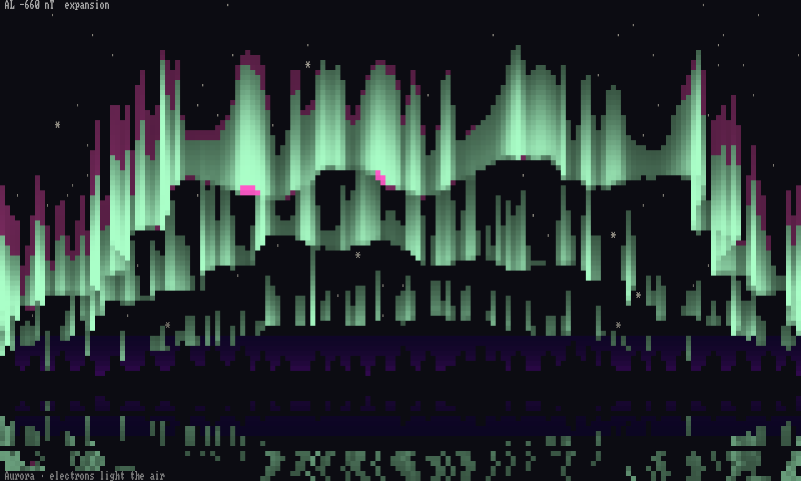

Auroral curtains folding over a still northern lake at night

[Historical looks](../samples/compare/aurora.png)

### `constellation_map`

A star chart tracing and naming one constellation at a time

[Historical looks](../samples/compare/constellation_map.png)

### `hurricane`

Spiral rain bands wind counter-clockwise into a clear eye; an infrared act

[Historical looks](../samples/compare/hurricane.png)

### `magnetosphere`

The solar wind meets Earth's magnetic field: bow shock, magnetotail, reconnection and aurora

### `meteor_shower`

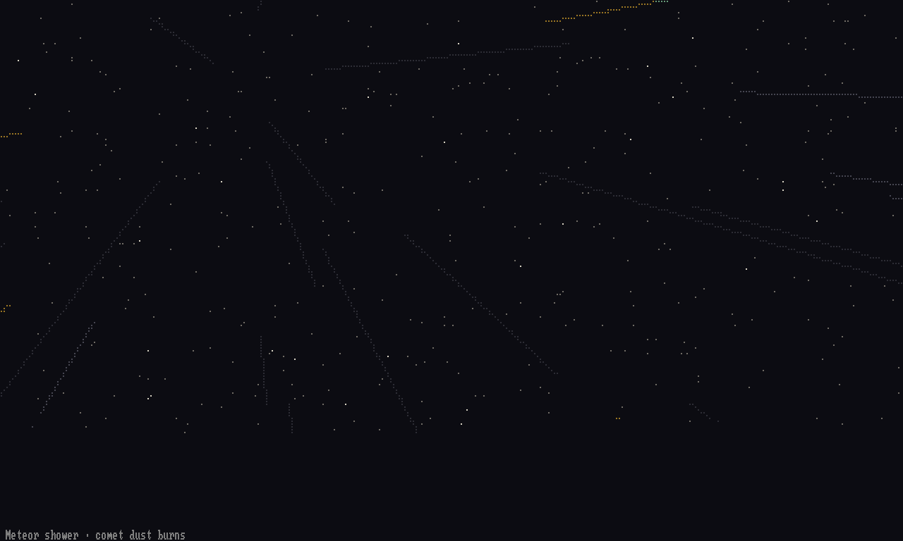

Perseid meteors fan out of one radiant; bright ones leave twisting green trains

[Historical looks](../samples/compare/meteor_shower.png)

### `moon_phases`

The Moon through a full lunation, with craters and the phase name

[Historical looks](../samples/compare/moon_phases.png)

### `noctilucent_clouds`

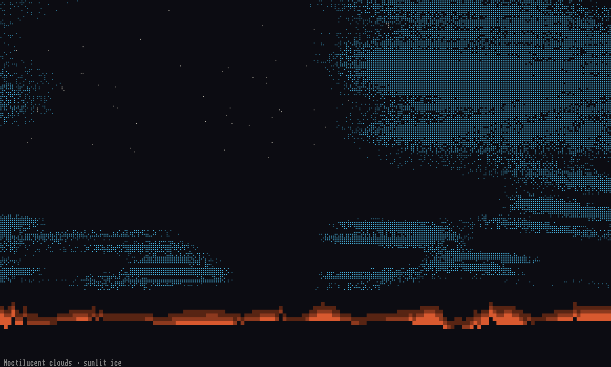

Electric-blue ice clouds at 83 km, still sunlit long after sunset

[Historical looks](../samples/compare/noctilucent_clouds.png)

### `rainbow`

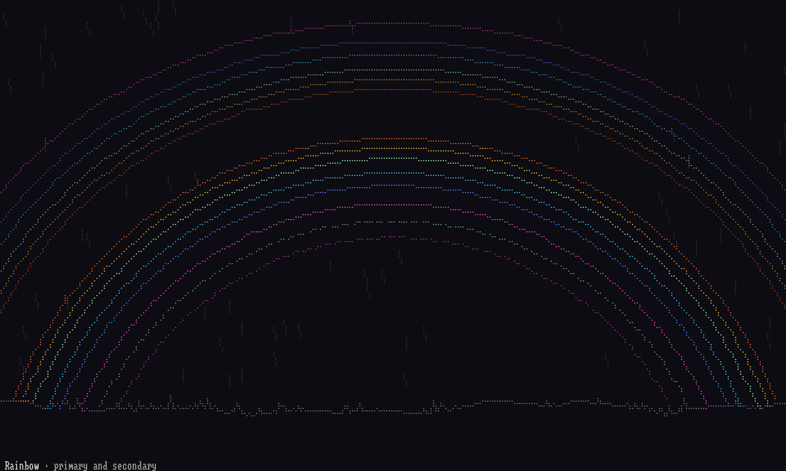

Light traced through a raindrop, then the primary and reversed secondary bows with Alexander's dark band

[Historical looks](../samples/compare/rainbow.png)

### `star_trails`

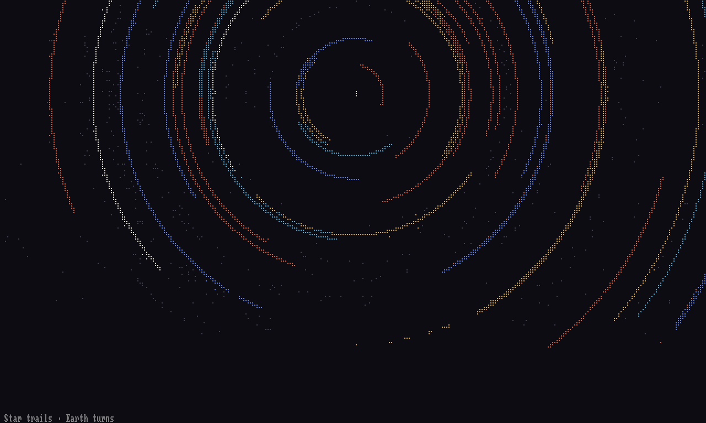

A long exposure: coloured star arcs grow around the pole above a treeline

[Historical looks](../samples/compare/star_trails.png)

### `total_solar_eclipse`

The Moon hides the Sun: Baily's beads, the diamond ring, the pearly corona

[Historical looks](../samples/compare/total_solar_eclipse.png)

## Voyages

### `gravity_assist`

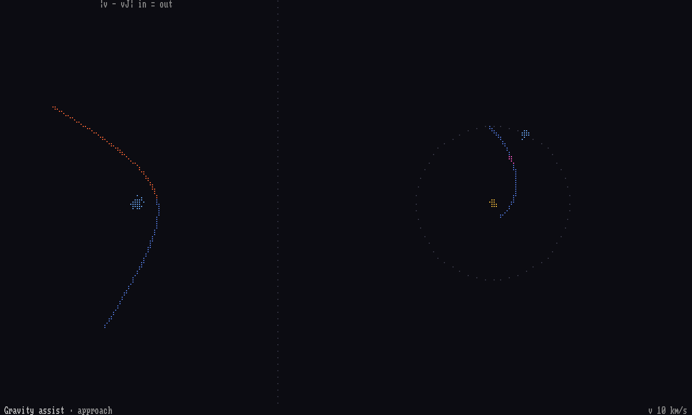

A probe swings past Jupiter: the same speed in Jupiter's frame, much faster in the Sun's

### `jwst_unfolding`

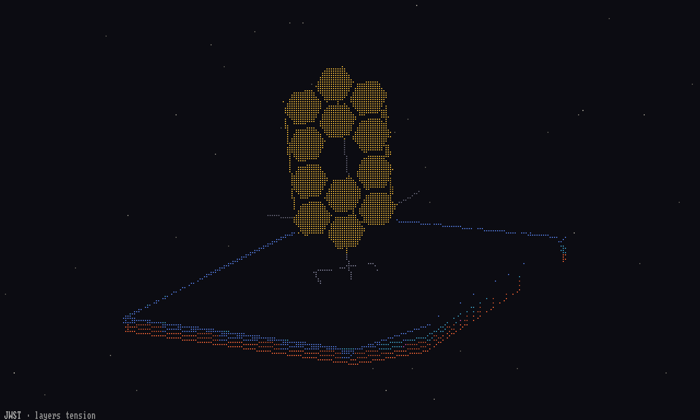

The James Webb Space Telescope unfolding its sunshield and mirror on the way to L2

[Historical looks](../samples/compare/jwst_unfolding.png)

### `mars_rover`

A rocker-bogie rover crossing Martian dunes, drilling and phoning home

[Historical looks](../samples/compare/mars_rover.png)

### `moon_landing`

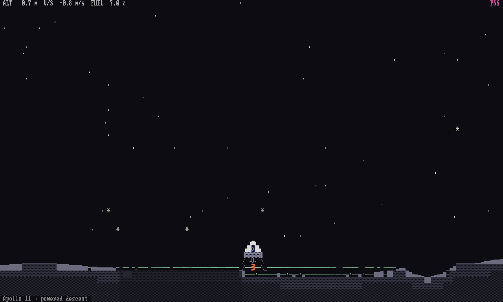

Apollo 11 powered descent to Tranquility Base

[Historical looks](../samples/compare/moon_landing.png)

### `orbital_rendezvous`

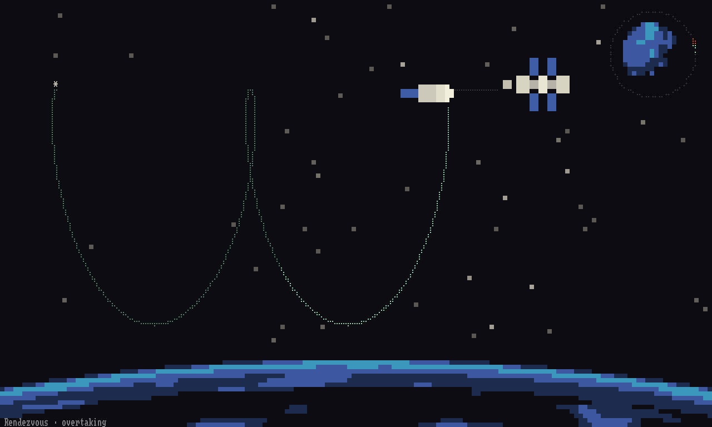

A chaser brakes to drop below a space station, overtakes it and docks

[Historical looks](../samples/compare/orbital_rendezvous.png)

### `rocket_launch`

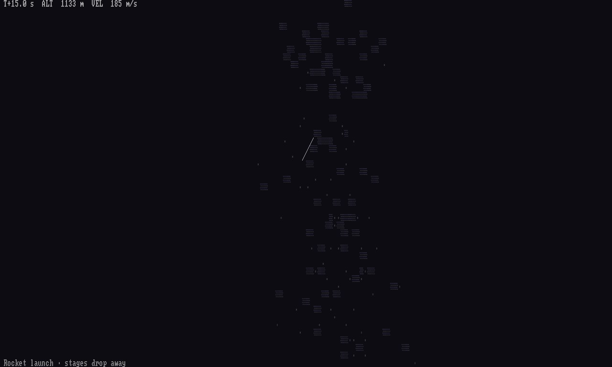

A rocket launch from countdown through stage separation

[Historical looks](../samples/compare/rocket_launch.png)

### `satellite_orbit`

A rotating Earth with satellites on inclined orbits

[Historical looks](../samples/compare/satellite_orbit.png)

### `voyager_journey`

Voyager 2 Grand Tour past Jupiter, Saturn, Uranus and Neptune

[Historical looks](../samples/compare/voyager_journey.png)

## Forces & Waves

### `brownian_motion`

A pollen grain jittering among solvent molecules (Langevin dynamics)

[Historical looks](../samples/compare/brownian_motion.png)

### `chladni_plate`

Sand on a vibrating plate gathers on the nodal lines, drawing Chladni figures

### `cloud_chamber`

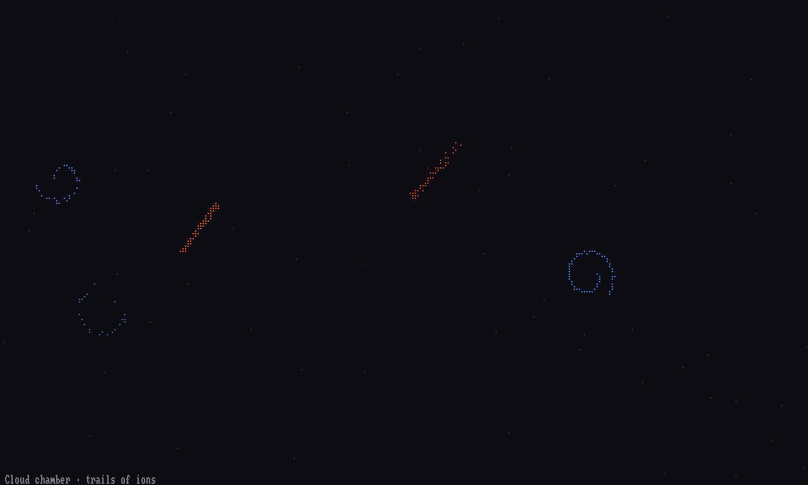

Alpha, beta and muon tracks condense and fade in a cloud chamber inside a magnetic field

### `doppler_effect`

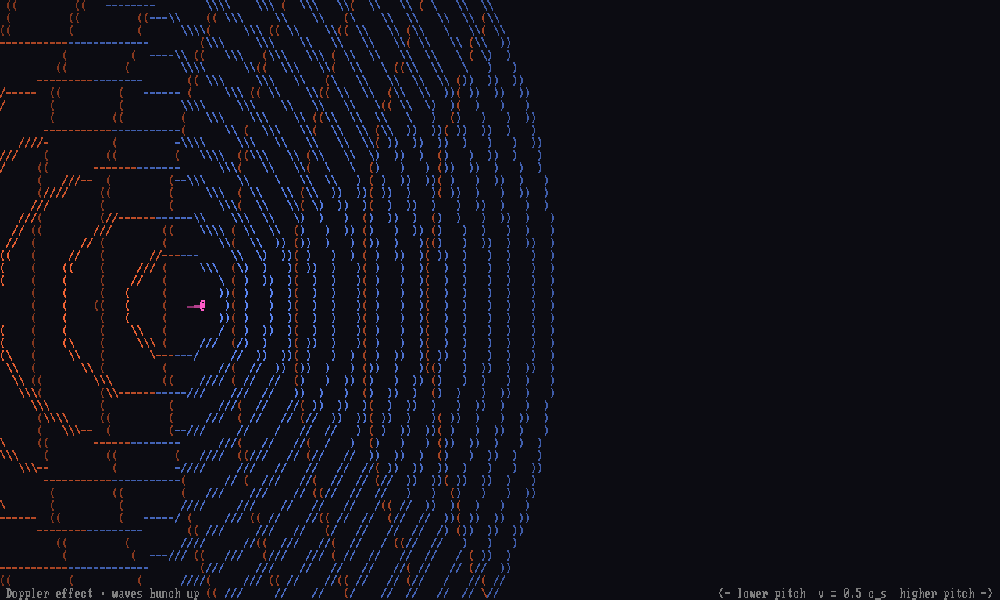

A moving source compressing wavefronts ahead and stretching them behind

[Historical looks](../samples/compare/doppler_effect.png)

### `double_pendulum`

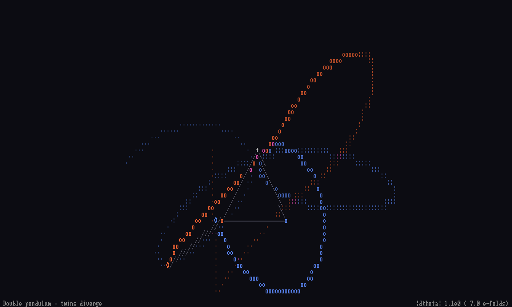

Twin double pendulums diverging chaotically from almost identical starts

[Historical looks](../samples/compare/double_pendulum.png)

### `kelvin_helmholtz`

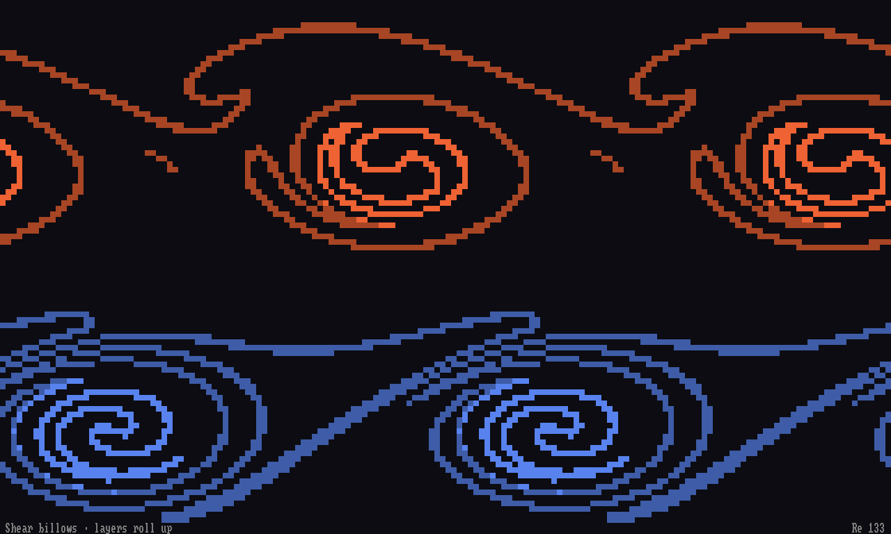

Kelvin-Helmholtz instability: two sliding layers roll up into billows that pair

[Historical looks](../samples/compare/kelvin_helmholtz.png)

### `particle_accelerator`

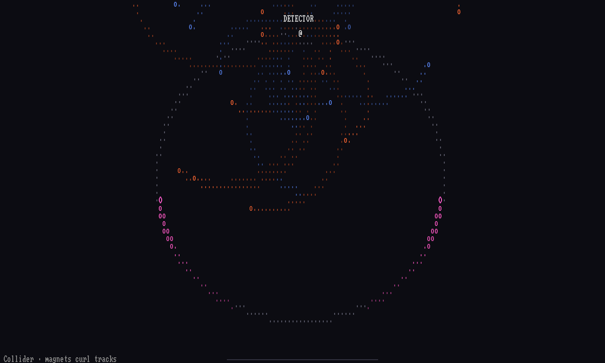

Counter-rotating bunches colliding into curling particle showers

[Historical looks](../samples/compare/particle_accelerator.png)

### `quantum_double_slit`

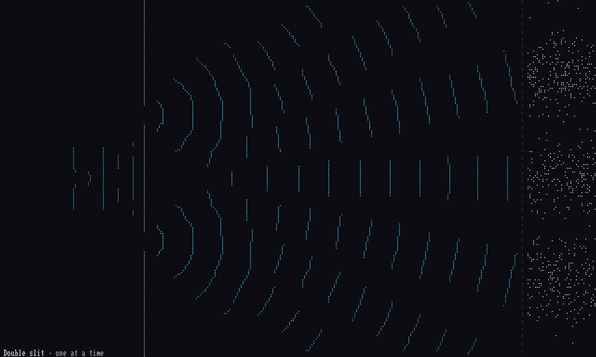

An electron wave packet diffracts through two slits; single clicks build the fringes

[Historical looks](../samples/compare/quantum_double_slit.png)

### `radioactive_decay`

A lattice of nuclei decaying through a chain beside live Bateman curves

[Historical looks](../samples/compare/radioactive_decay.png)

### `rayleigh_benard`

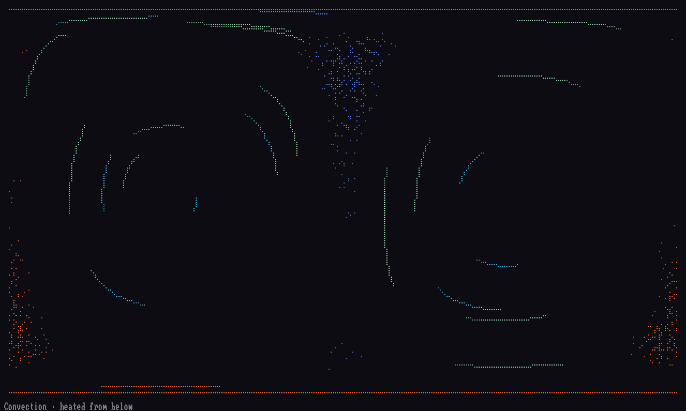

A fluid layer heated from below turns over in convection rolls

### `strange_attractors`

A turning gallery of chaotic attractors traced by swarms of glowing threads

[Historical looks](../samples/compare/strange_attractors.png)

### `three_body`

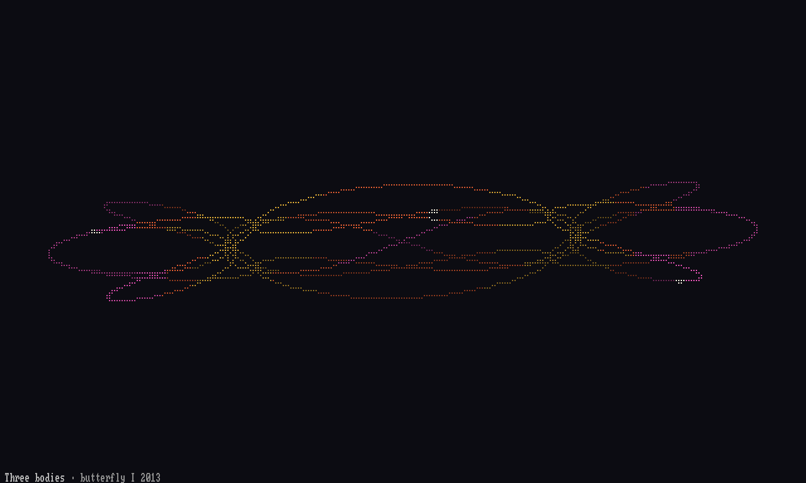

Three equal suns on periodic three-body orbits, their shadow clouds showing chaos

[Historical looks](../samples/compare/three_body.png)

### `vortex_street`

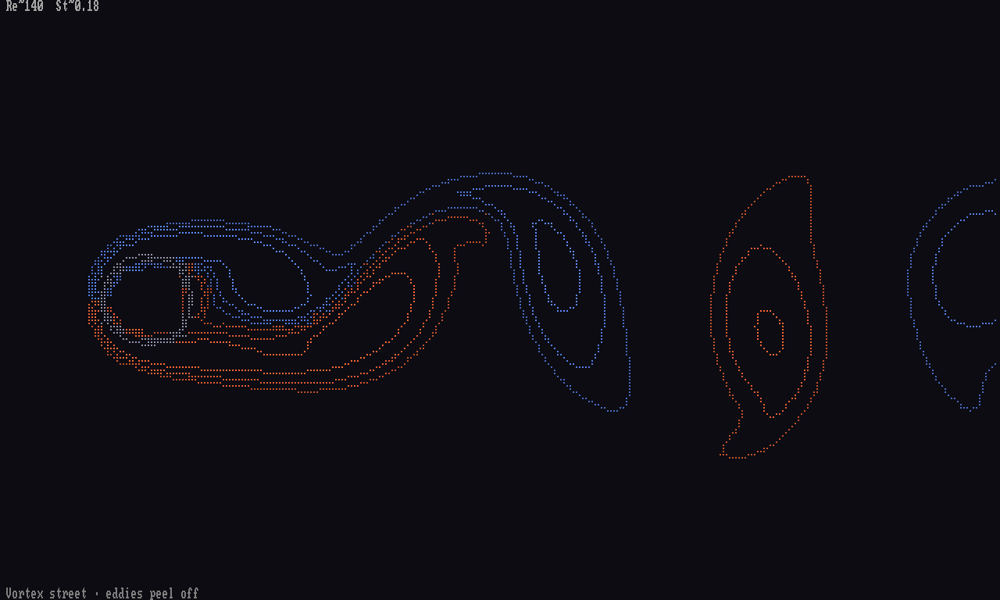

A von Karman vortex street shed from a cylinder at Re ~ 130

[Historical looks](../samples/compare/vortex_street.png)

### `wave_interference`

Two coherent sources whose ripples interfere into bright and dark bands

[Historical looks](../samples/compare/wave_interference.png)

## Reactions

### `belousov_zhabotinsky`

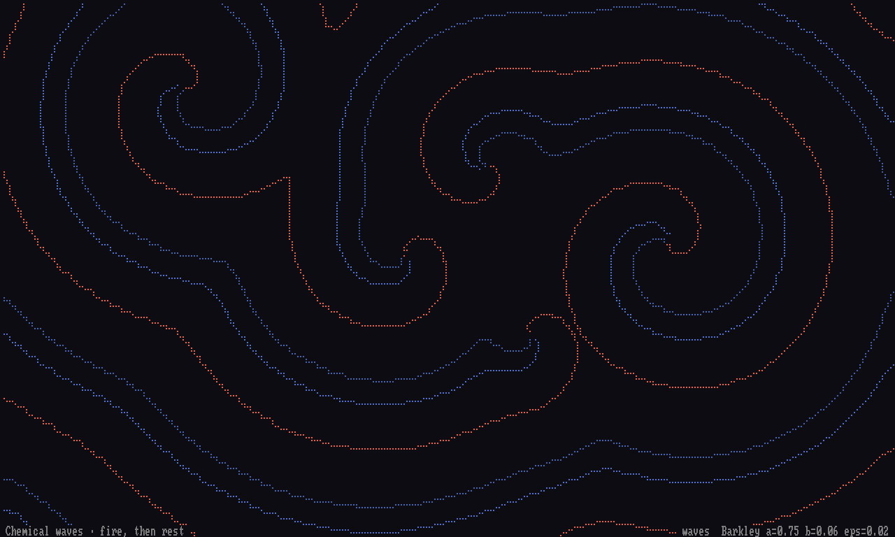

Belousov-Zhabotinsky dish: spiral and target oxidation waves sweeping a dark medium

[Historical looks](../samples/compare/belousov_zhabotinsky.png)

### `catalytic_surface`

CO oxidation on a platinum surface: the Ziff-Gulari-Barshad lattice model swept through its reactive window

[Historical looks](../samples/compare/catalytic_surface.png)

### `gray_scott`

Gray-Scott reaction-diffusion growing self-replicating spots and worms

[Historical looks](../samples/compare/gray_scott.png)

### `liesegang_rings`

Liesegang bands snapping into place down a rack of gel columns

[Historical looks](../samples/compare/liesegang_rings.png)

### `molecule_viewer`

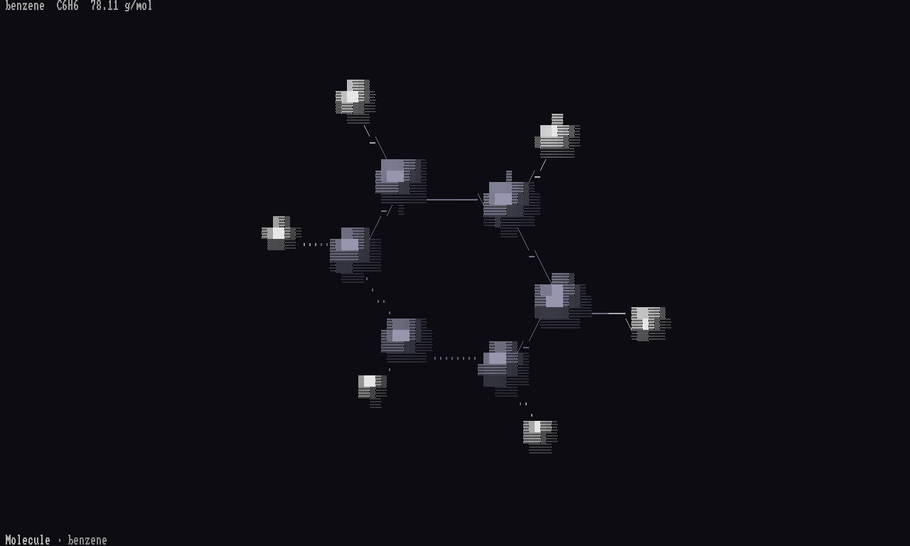

Tumbling ball-and-stick models of real molecules, from water to buckminsterfullerene

[Historical looks](../samples/compare/molecule_viewer.png)

### `radical_chain`

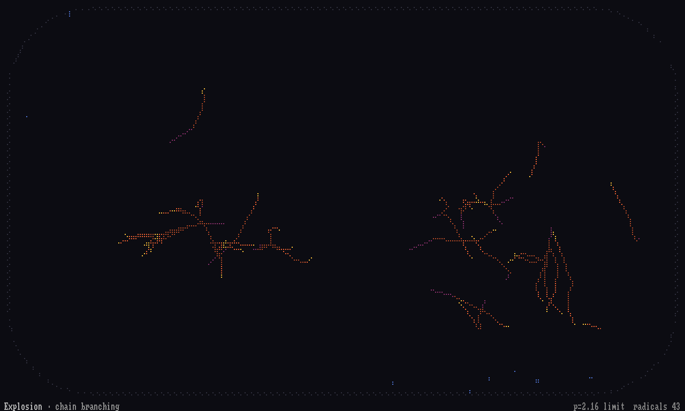

Hydrogen-oxygen chain branching: radicals die on the walls below the explosion limit and multiply into a flash above it

[Historical looks](../samples/compare/radical_chain.png)

## Living Systems

### `boids_flocking`

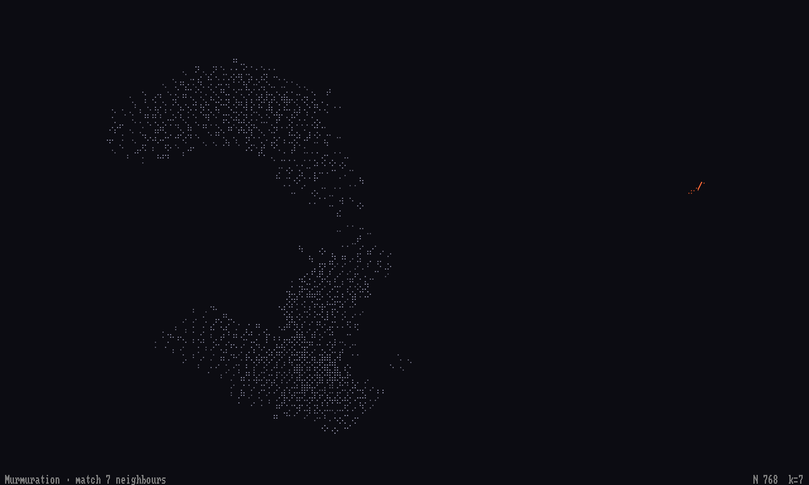

A starling murmuration at dusk, rippling away from a stooping falcon

[Historical looks](../samples/compare/boids_flocking.png)

### `firefly_sync`

Fireflies on a mangrove flash at random, then fall into step (Mirollo-Strogatz pulse coupling)

[Historical looks](../samples/compare/firefly_sync.png)

### `lenia`

Lenia: Orbium gliders swim across a continuous cellular automaton, torn and regrown

[Historical looks](../samples/compare/lenia.png)

### `physarum`

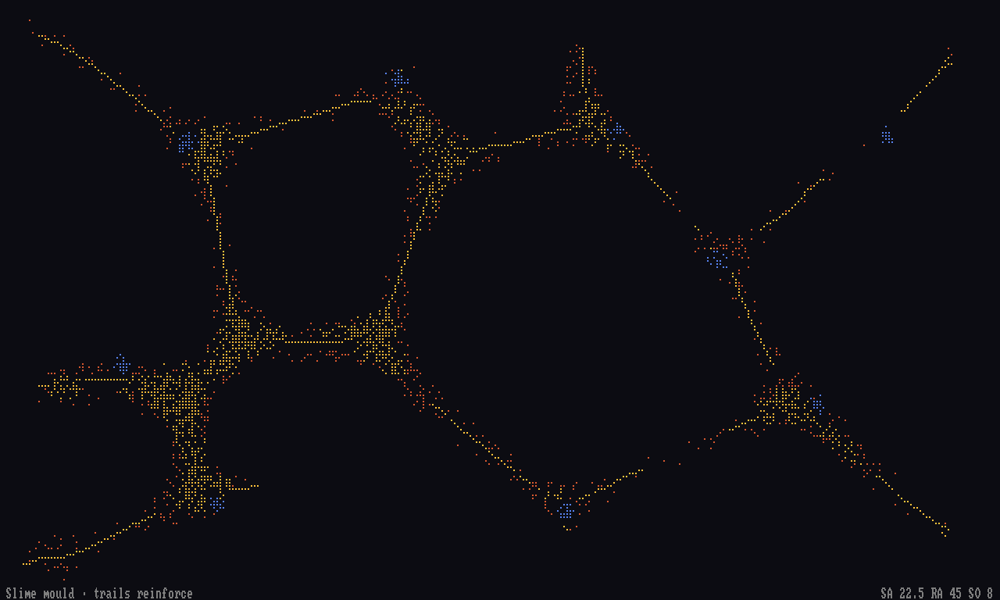

A slime mould spreading a lace of veins that thickens into a transport network

[Historical looks](../samples/compare/physarum.png)

## States of Matter

### `chemical_garden`

Chemical garden: salt crystals in water glass grow tubes in osmotic bursts; a hydrothermal-vent chimney

[Historical looks](../samples/compare/chemical_garden.png)

### `electron_orbitals`

Hydrogen orbitals as turning Monte-Carlo clouds, sloshing between states

[Historical looks](../samples/compare/electron_orbitals.png)

### `fractal_growth`

A dendrite growing by diffusion-limited aggregation, then melting and regrowing

[Historical looks](../samples/compare/fractal_growth.png)

### `ising_model`

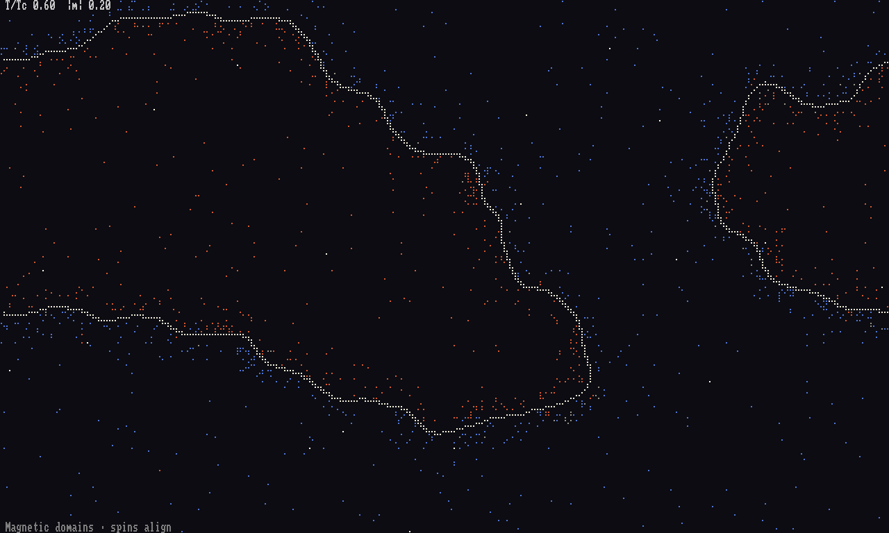

The Ising ferromagnet quenched, reheated and cooled through its critical point

[Historical looks](../samples/compare/ising_model.png)

### `lichtenberg_discharge`

Dielectric breakdown burns a branching Lichtenberg tree into acrylic

[Historical looks](../samples/compare/lichtenberg_discharge.png)

### `molecular_dynamics`

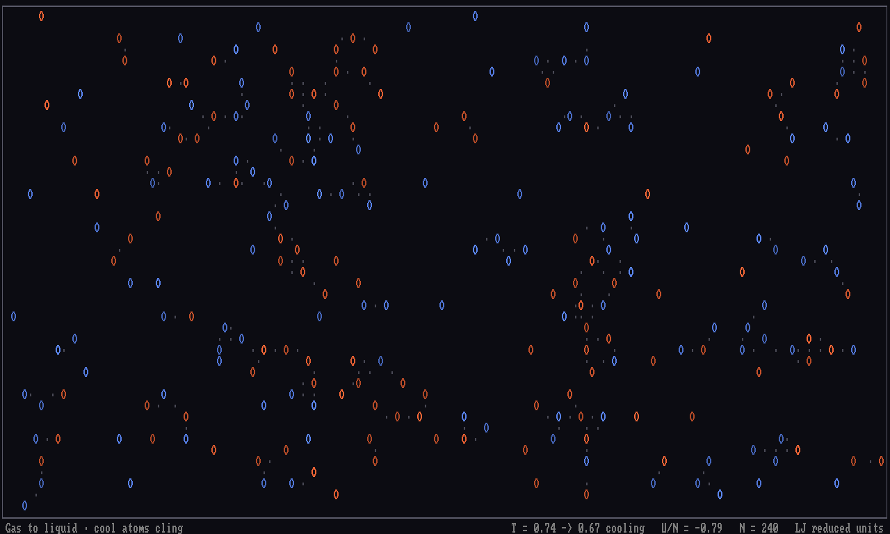

A Lennard-Jones fluid melting and condensing as it is heated and cooled

[Historical looks](../samples/compare/molecular_dynamics.png)

### `snowflake_growth`

A snow crystal grows from vapour on a hexagonal lattice (Reiter model), showing growth rings

### `spinodal_decomposition`

Cahn-Hilliard phase separation: a quenched mixture unmixes and its domains coarsen

[Historical looks](../samples/compare/spinodal_decomposition.png)

## Physics of Life

### `action_potential`

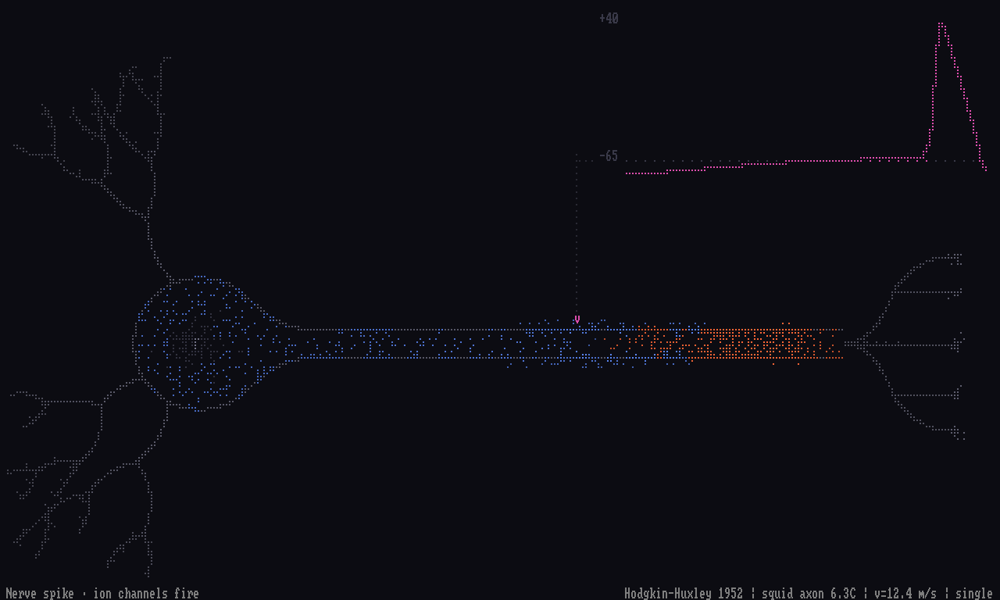

A nerve impulse racing down an axon, with an oscilloscope trace of the spike

[Historical looks](../samples/compare/action_potential.png)

### `heart_fibrillation`

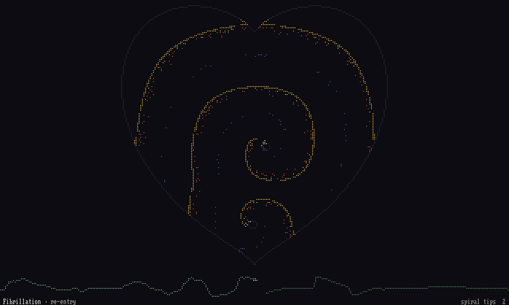

Heart tissue as a phase map: sinus beats, a re-entrant spiral, breakup into fibrillation, a defibrillator shock

[Historical looks](../samples/compare/heart_fibrillation.png)

### `mitosis`

A cell divides: chromosomes condense, align on the spindle, split and the cell pinches in two

### `motility_clustering`

Active Brownian swimmers (bacteria) jam into clusters that coarsen: motility-induced phase separation

[Historical looks](../samples/compare/motility_clustering.png)

## Molecules of Life

### `dicty_aggregation`

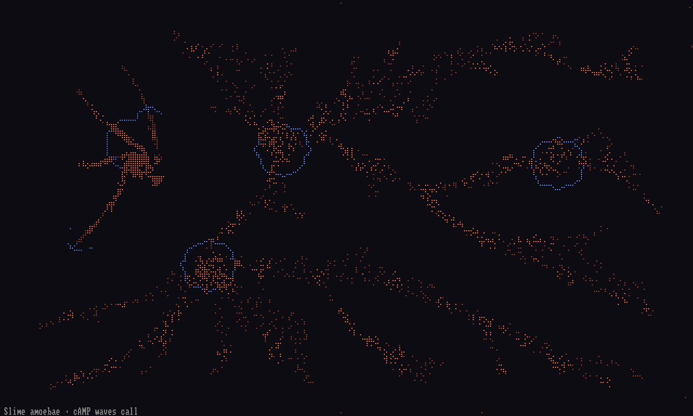

Slime-mould amoebae relay spiral cAMP waves and stream up the gradient into mounds

[Historical looks](../samples/compare/dicty_aggregation.png)

### `dna_helix`

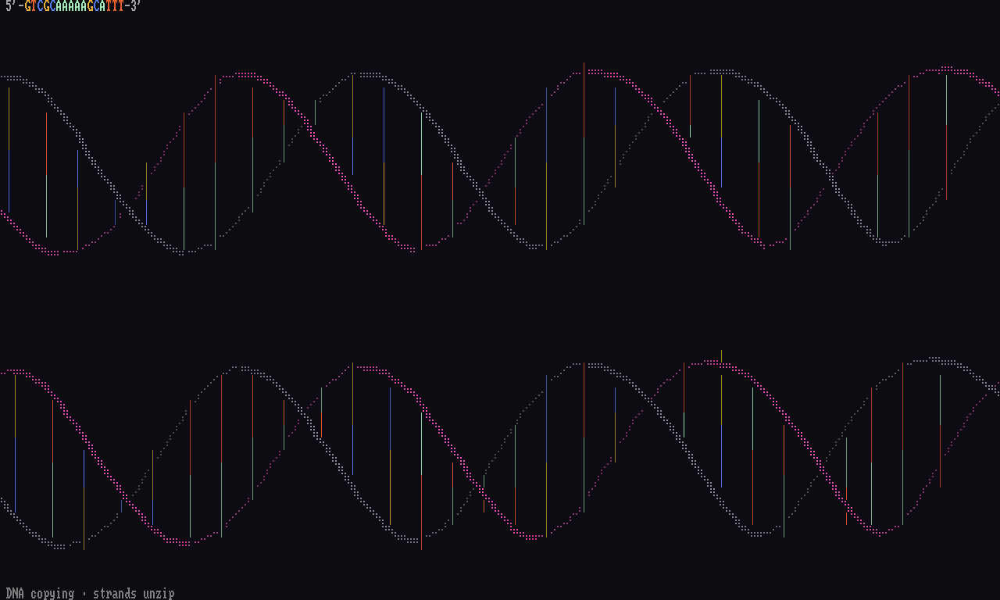

The DNA double helix turning in space, unzipped and copied by a replication fork

[Historical looks](../samples/compare/dna_helix.png)

### `ribosome_translation`

A ribosome reads mRNA codon by codon; tRNAs bring amino acids and the protein chain grows

## Life from Matter

### `hp_protein_folding`

HP lattice protein: a hot coil cools and collapses, hiding its hydrophobic residues in a core

[Historical looks](../samples/compare/hp_protein_folding.png)

### `molecular_motors`

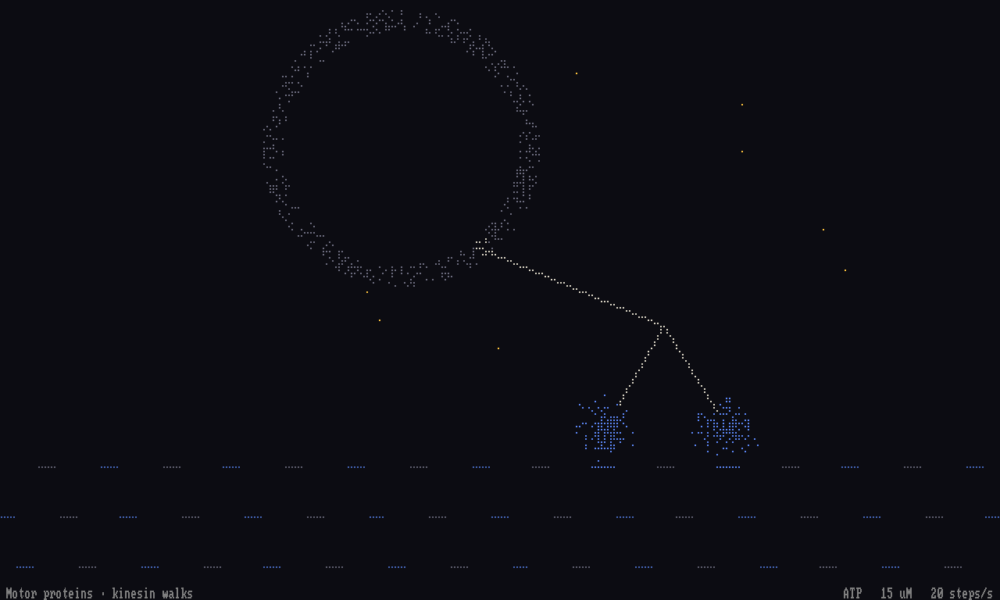

Kinesin walks hand over hand, one 8 nm step per ATP; ATP synthase turns in 120-degree steps

[Historical looks](../samples/compare/molecular_motors.png)

### `protocell_assembly`

Amphiphiles in water self-assemble into micelles, bilayers and a vesicle

Generated by `python3 scripts/gallery.py` (`pixi run rs-gallery`); do not edit by hand.
